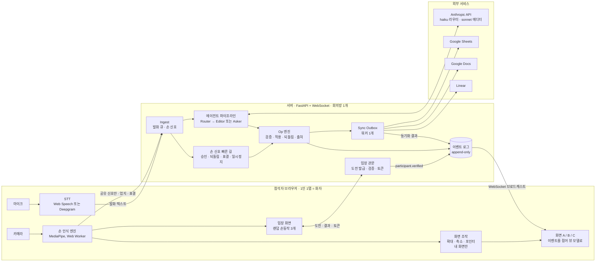
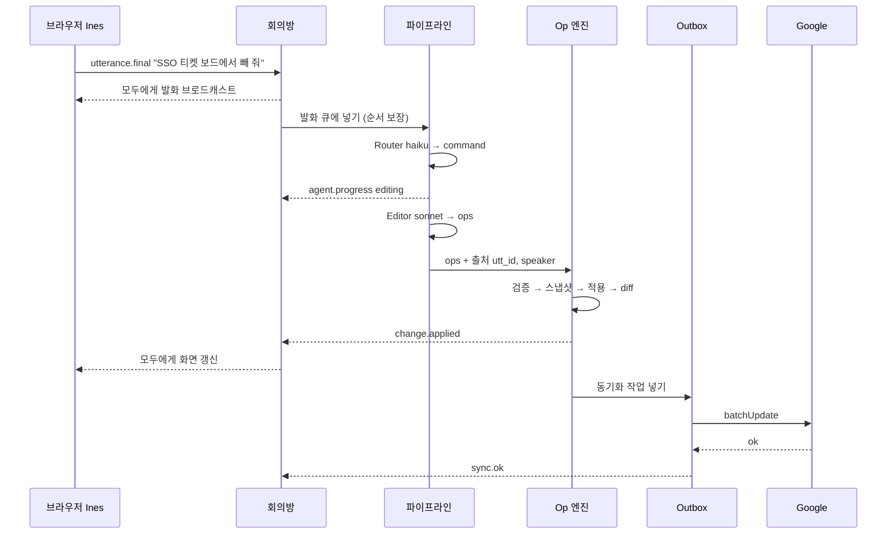
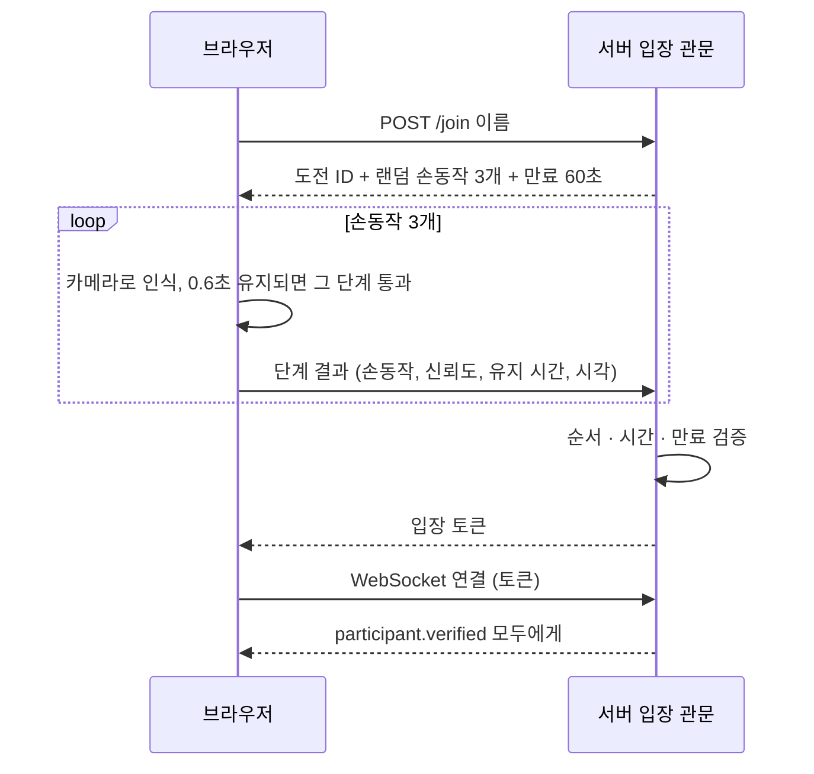
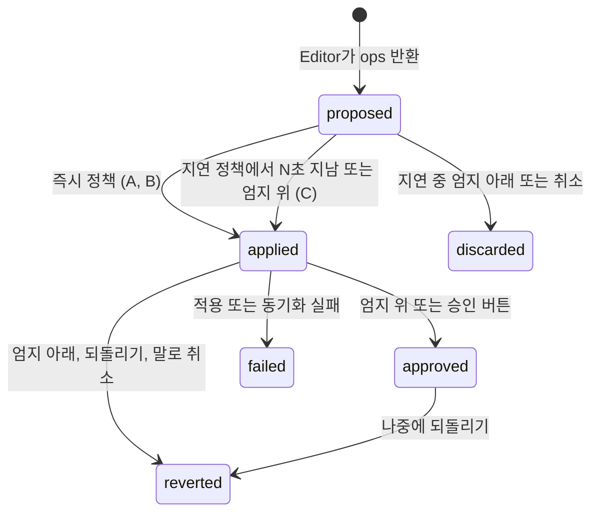

# 회의 에이전트 — 본선 아키텍처 초안

> v0.1 · 2026-11-08 · 브레인스토밍용 초안. 본선에서는 새 레포에 처음부터 짠다.
> PoC(`meeting-agent-poc`, 손 인식이 붙은 `meeting-agent-poc-hs`)에서 검증된 것만 가져오고 구조는 새로 잡는다.
> 화면 시안: 회의 에이전트 UI 시안 캔버스 (A 채팅 중심 / B 캔버스 하나 / C 문서 중심)

---

## 0. 한 줄 요약

- **백엔드와 데이터 계약(이벤트 · op · 문서 모델)은 A/B/C 공통이다.** 화면은 같은 이벤트 로그를 다르게 보여 주는 "뷰"일 뿐이다.
- 예외는 두 가지다.
  - **B·C는 문서의 칸·항목마다 고정 ID(앵커)가 필요하다.** "이 칸은 누가 몇 분에 바꿨나"를 붙이려면 있어야 한다.
  - **C의 제안 모드(몇 초 뒤 자동 반영, 엄지 아래면 취소)는 백엔드에 "지연 커밋"이 하나 더 필요하다.**
- 그래서 **코어는 처음부터 앵커 기반 op + 변경 수명주기로 짜고, 화면은 B부터 만든다.** 그러면 A·C는 나중에 뷰만 추가하면 된다.
- **손 인식(입장 관문, 확대·축소)도 A/B/C와 무관하게 공통이다.** 입장 화면은 셋이 같고, 확대할 영역만 화면마다 다르다.
- 손 인식은 `meeting-agent-poc-hs`의 엔진에서 출발하되, **모드 분리**(기본 / 확대 / 입장)와 **확대·축소는 서버에 안 보내는 로컬 조작**이라는 두 가지를 먼저 정한다.

---

## 1. 목표와 제약

| 항목 | 내용 |
|---|---|
| 한 줄 피치 | Say it in the meeting. The doc changes. 모든 변경에 누가 말했는지 붙는다 |
| 팀 원칙 | 말은 회의에, 손은 에이전트에 |
| 손 인식이 들어가는 곳 | ① 입장 화면: 랜덤 손동작 3개를 통과해야 들어온다(참석자가 AI가 아닌 사람인지 확인) ② 회의 중: 손으로 확대·축소, 가능하면 다른 모션까지 |
| 지연 목표 | 말 → 화면 p50 3초 미만 (PoC 실측 p50 3.1초, p95 4.3초, 라우터 단독 0.9초) |
| 손 신호 목표 | 1초 안에 반영 (평가 대본 작성 규격 4절) |
| 조건 | 하루 해커톤, 4명, 새 레포 |
| 환경 제약 | 브라우저 마이크는 localhost나 https에서만 열림. Google API는 동시 호출하면 깨짐(아래 3-5) |

---

## 2. 전체 구조



- 접속한 브라우저가 곧 화자다. 그래서 화자 분리(diarization)가 필요 없다. PoC와 같은 방식이다.
- 손 인식 엔진 하나를 입장 화면과 회의 화면이 같이 쓴다. 카메라는 입장할 때 한 번 켜서 회의 끝까지 유지한다.
- **확대·축소·포인터는 내 화면만 바꾸므로 서버에 보내지 않는다.** 서버로 가는 건 입장 결과와, 모두에게 영향을 주는 신호(엄지, 표결)뿐이다.
- 서버 안에서 모든 것은 **이벤트 로그**에 한 줄씩 쌓인다. 화면, 리플레이, 지연 측정, 디버깅이 전부 이 로그를 읽는다.

---

## 3. 핵심 설계 결정 5개

### 3-1. 이벤트 로그가 단일 진실이다
- 서버는 상태를 바꿀 때마다 이벤트를 하나 남기고 클라이언트에 그 이벤트만 보낸다. 접속할 때는 스냅샷과 최근 이벤트를 보낸다.
- PoC는 결과가 나올 때마다 전체 state를 브로드캐스트했다. 그러면 무엇이 바뀌었는지 화면이 다시 계산해야 한다.
- 이렇게 하면 A/B/C 전환, 리플레이, 녹화 재생 데모, 지연 측정이 모두 공짜로 따라온다.

### 3-2. op는 앵커 기반의 작은 수정이다
- PoC의 `edit_doc`은 섹션 하나를 통째로 다시 썼다. 그래서 어느 줄이 바뀌었는지 정확히 칠하기 어렵다.
- 새 구조에서는 항목 단위 op(`insert_item`, `update_item`, `delete_item`)로 바꾼다. 모든 칸과 항목은 고정 ID를 가진다.
- 얻는 것: 정확한 하이라이트(B), 여백 카드 위치 고정(C), Google batchUpdate 범위 축소.

### 3-3. 변경(Change)은 수명주기를 가진 객체다
- 상태: `proposed → applied → approved | reverted`, 실패하면 `failed`.
- **커밋 정책**은 설정값이다. 즉시 반영(A·B)과 지연 반영(C 제안 모드)을 코드 분기 없이 고른다.
- 되돌리기는 "마지막 것"만이 아니라 **특정 변경**을 되돌린다. 되돌릴 때는 diff에서 역연산을 만든다.

### 3-4. 손 인식은 세 갈래로 나누고, 어느 것도 LLM을 거치지 않는다
- **입장 관문**: 서버가 랜덤 손동작 3개를 내고, 브라우저가 인식하고, 서버가 순서와 시간을 검증해 입장 토큰을 준다.
- **로컬 화면 조작**: 확대·축소, 포인터, 클릭. 브라우저 안에서 끝나고 서버로 가지 않는다. 사람마다 자기 화면만 바뀐다.
- **공유 신호**(가능하면 추가): 엄지 위·아래로 방금 수정 승인·되돌림, 손가락 개수로 표결, T자로 일시정지. 서버의 빠른 길에서 규칙으로 처리하니 1초 목표를 지킬 수 있다.
- 자세한 규칙은 5-2절에 있다.

### 3-5. 외부 동기화는 Outbox 하나로 줄 세운다
- 화면은 Google을 기다리지 않는다. 로컬 상태를 먼저 바꾸고 동기화 상태는 칩으로 따로 보여 준다.
- PoC 실측: Google 호출을 8스레드로 동시에 보내면 16건 중 12건이 SSL 오류로 실패했고, 1스레드로 줄이면 16건 모두 성공했다.
- 재시도는 Outbox가 맡고, 실패는 `sync.failed` 이벤트로 화면에 보인다.

---

## 4. 데이터 계약 — 첫 1시간 안에 팀이 고정할 것

이 세 가지(이벤트, 문서 모델, op)만 먼저 정하면 4명이 서로 기다리지 않고 동시에 작업할 수 있다.

### 4-1. 이벤트

공통 형식:

```json
{
  "seq": 128,
  "ts": 201.4,
  "type": "change.applied",
  "actor": "agent",
  "refs": {"utt_id": "u57", "change_id": "c23"},
  "payload": {}
}
```

| 분류 | type | 만드는 곳 | payload 핵심 |
|---|---|---|---|
| 참석 | `participant.joined`, `participant.verified`, `participant.rejected` | 입장 관문 | name, 손동작 3개, 결과, 걸린 시간 |
| 발화 | `utterance.interim`, `utterance.final` | 브라우저 STT → 서버 | speaker, text |
| 손 | `gesture` | 브라우저 손 인식 | kind, confidence, hold_ms |
| 표결 | `vote.opened`, `vote.cast`, `vote.closed` | 빠른 길 | question, votes, counted |
| 에이전트 | `agent.routed`, `agent.progress` | 파이프라인 | label, stage, ms |
| 변경 | `change.proposed`, `change.applied`, `change.approved`, `change.reverted`, `change.failed` | Op 엔진 | Change 객체(4-4) |
| 묻기 | `ask.answered` | Asker | answer, 근거 utt_id |
| 동기화 | `sync.ok`, `sync.failed`, `doc.pulled` | Outbox | target, error |
| 제어 | `agent.paused`, `agent.resumed`, `room.reset` | 서버 | 누가, 왜 |

결정 사항, 충돌, 액션은 별도 이벤트가 아니라 **변경 안의 op**로 둔다. 화면은 op 종류를 보고 "결정 필요" 카드 같은 것을 그린다.

### 4-2. 문서 모델 (Google에 묶이지 않는 중립 형식)

```json
{
  "docs": {
    "board": {
      "kind": "sheet",
      "title": "스프린트 24 보드",
      "columns": ["티켓", "제목", "추정", "담당", "상태"],
      "rows": [
        {"row_id": "r_pay423", "cells": {"티켓": "PAY-423", "제목": "API 요청 제한기", "추정": 5, "담당": "Owen", "상태": "이번 스프린트"}}
      ]
    },
    "notes": {
      "kind": "doc",
      "title": "회의 노트",
      "sections": [
        {"section_id": "s_dec", "heading": "결정 사항", "binding": "decisions", "items": []},
        {"section_id": "s_risk", "heading": "리스크", "binding": "risks", "items": []},
        {"section_id": "s_act", "heading": "액션", "binding": "actions", "items": []},
        {"section_id": "s_free1", "heading": "범위", "binding": null,
         "items": [{"item_id": "i_7", "text": "Public App Store / Play Store release"}]}
      ]
    }
  },
  "conflicts": [],
  "tickets": [],
  "provenance": {"board/r_pay423/추정": "c19"}
}
```

- **앵커 형식**: 칸은 `board/r_pay423/추정`, 문서 항목은 `notes/s_risk/i_12`.
- **binding**: 노트 문서의 결정·리스크·액션 섹션은 그 종류의 기록과 같은 것이다. PoC처럼 decisions 목록과 문서 섹션을 따로 두지 않는다. 그러면 같은 내용이 두 군데 생기지 않는다.
- **provenance**: 앵커마다 마지막으로 바꾼 change_id를 기록한다. B의 칸 팝오버와 C의 여백 카드가 이걸 읽는다.

### 4-3. op — 한 파일에서 정의하고 나머지는 거기서 만든다

op 정의 한 곳(레지스트리)에서 LLM 툴 스키마, 검증, 적용, 역연산, Google 요청 변환을 모두 만든다. PoC는 PoC마다 확장 op가 흩어져 있었다.

| 종류 | op |
|---|---|
| 시트 | `set_cell(row, column, value)`, `add_row(values)`, `delete_row(row)` |
| 문서 | `insert_item(section, text, after?)`, `update_item(item, text)`, `delete_item(item)`, `add_section(heading)`, `rename_section(section, heading)` |
| 기록 | `add_decision`, `add_action`, `claim_action`, `add_note`, `create_ticket`, `open_conflict`, `resolve_conflict` |
| 말로 하는 취소 | `undo_last` ("방금 거 취소해 줘"처럼 대상을 말하지 않을 때만) |

- 승인과 되돌리기 버튼, 엄지 신호는 op가 아니라 **변경의 상태 전이**다.
- **평가 대본 호환**: 평가 대본의 정답 op 12종과 이름을 맞춘다. `edit_doc`은 `insert_item`/`update_item`으로 쪼개지만, 채점할 때는 다시 `edit_doc`으로 묶어서 센다.

### 4-4. Change

```json
{
  "change_id": "c23",
  "utt_id": "u57",
  "requested_by": "Ines",
  "via": "voice",
  "ops": [{"op": "add_row", "values": {"제목": "불안정한 결제 테스트", "추정": 2, "담당": "Ravi"}}],
  "targets": ["board/r_new1"],
  "diff": [{"anchor": "board/r_new1", "before": null, "after": {"제목": "불안정한 결제 테스트"}}],
  "status": "applied",
  "policy": "immediate",
  "reason": "Ines가 티켓 생성을 요청",
  "approvals": [{"by": "Owen", "via": "THUMB_UP", "ts": 166.2}],
  "latency_ms": {"route": 610, "edit": 1500, "apply": 4, "sync": 320}
}
```

---

## 5. 흐름

### 5-1. 발화 하나가 문서를 바꾸기까지



- 발화는 회의방마다 큐 하나로 **순서대로** 처리한다. 앞 발화의 결과를 다음 발화가 봐야 하기 때문이다.
- 지연을 줄이려면 6절의 방법을 쓴다.

### 5-2. 손 인식

출발점은 `meeting-agent-poc-hs`의 `PaHsGestureEngine`이다. 지금 구조는 이렇다.
- MediaPipe Gesture Recognizer를 메인 스레드에서 매 프레임 돌린다. 한 손만 본다.
- 검지 끝으로 포인터를 움직인다.
- 손을 편 정도(openness)로 확대·축소한다. 먼저 주먹과 손바닥을 보여 줘서 보정해야 한다.
- 주먹은 최소 배율, 손바닥은 최대 배율로 바로 간다.
- 화면 전체(`<main>`)에 CSS transform을 걸고, 포인터 위치를 기준으로 확대한다.

#### 5-2-1. 입장 관문 (로그인 화면)

목적: 회의에 들어오는 참석자가 AI가 아니라 카메라 앞에 있는 사람인지 확인한다.



- **도전은 서버가 만든다.** 브라우저가 고르면 미리 녹화한 영상으로 통과할 수 있다. 매번 랜덤 3개, 만료 60초.
- **손동작 후보**: 인식이 안정적인 것부터 쓴다.
  - MediaPipe 기본 제스처: Thumb_Up, Thumb_Down, Pointing_Up, Victory, Open_Palm, Closed_Fist, ILoveYou
  - 직접 규칙으로 만드는 것: 손가락 1~5개 (21개 랜드마크로 계산)
  - 비슷해서 헷갈리는 쌍(Victory와 손가락 2개)은 같은 도전에 같이 넣지 않는다.
- **입장 화면 UI**: 큰 카메라 미리보기, 지금 해야 할 손동작 그림 1개 + 진행 표시 3칸, 유지 시간 게이지, "다시 시도". 3번 실패하면 호스트가 수동으로 들여보낼 수 있게 한다(시연 사고 대비).
- **보정도 여기서 끝낸다**: 통과 직후 "주먹 → 손바닥"을 2초 보여 달라고 해서 확대·축소 보정값을 저장한다. 그러면 회의 화면에서 보정 안내가 따로 필요 없다.
- **한계**: 인식은 브라우저에서 하므로, 마음먹고 가상 카메라로 생성 영상을 넣으면 뚫을 수 있다. 랜덤 도전과 만료로 문턱을 높이는 정도다. 여유가 있으면 각 단계의 랜드마크 몇 프레임을 서버로 보내 손 모양을 다시 확인한다(P2).
- 입장 미확인 참석자는 들어오지 못한다. 평가 묶음 D 회의처럼 "미확인으로 참관만" 허용할지는 14절에서 정한다.

#### 5-2-2. 회의 중 화면 조작 (내 화면만)

| 동작 | 손 | 지금 PoC-hs | 바꿀 점 |
|---|---|---|---|
| 포인터 | 검지 들기 (Pointing_Up) | 있음 | 그대로. 포인터 위치가 확대 기준점 |
| 확대·축소 | 손을 편 정도 | 있음, 늘 켜져 있음 | **"확대 모드"를 켰을 때만** 동작. 손을 그냥 흔들거나 말하면서 손짓해도 화면이 튀지 않게 |
| 확대 모드 켜기·끄기 | Victory(브이) 0.5초 유지 또는 화면 버튼 | 없음 | 손이 3초 안 보이면 자동으로 꺼짐 |
| 원래 크기로 | 주먹 0.5초 유지 | 주먹 = 최소 배율로 바로 감 | 최소 배율 대신 100%로 복귀 |
| 클릭 | 포인터를 한 곳에 1초 머물기 | 할 일 목록에 있음 | 칸 위에서 머물면 "누가 언제 말했나" 팝오버 열기 |
| 문서 탭 넘기기 (B) | 손바닥을 좌우로 쓸기 | 없음 | 손목 x 속도로 판단. P2 |

- **확대 대상은 화면 전체가 아니라 문서 영역만**이다. 상단 바, 대화 타임라인, 에이전트 바는 그대로 둔다. 지금 PoC-hs는 `<main>` 전체를 키운다.
  - A: 문서 팝업 안, B: 캔버스(보드·노트) 안, C: 문서 페이지
- 확대 상태(배율, 기준점)는 화면 상태일 뿐이라 이벤트 로그에 남기지 않는다.

#### 5-2-3. 공유 신호 (가능하면 추가하는 모션)

서버로 보내서 모두에게 영향을 주는 신호다. 서버의 빠른 길에서 규칙으로 처리한다.

| 신호 | 처리 | 비고 |
|---|---|---|
| 엄지 위 | 최근 15초 안에 applied된 변경 중 가장 최근 것을 approved로 | 대상이 없으면 무시하고 작은 안내만 |
| 엄지 아래 | 같은 대상을 reverted로 (지연 커밋 중이면 discarded) | 평가 대본: 9초 전 수정을 거부하는 장면 있음 |
| 손가락 0~5 | 입장 확인된 사람 2명 이상이 2초 안에 같이 보이면 `vote.opened` → 각자 `vote.cast` → 5초 조용하면 `vote.closed` | 질문은 직전 대사로 LLM이 비동기로 만든다 |
| 가리키기(방금 것) | 다음 발화에 "방금 언급된 것" 힌트를 붙여 Editor에 최근 30초 언급 목록을 준다 | "그거, 5요, 넣어 줘" |
| T자 | 에이전트 일시정지 / 재개 | 두 손이 필요해서 numHands 2 |

#### 5-2-4. 엔진 공통 사항

- **손동작끼리 겹치지 않게 모드를 나눈다.** 지금 PoC-hs는 손가락 2개 이상이면 확대 모드로 들어간다. 그러면 손가락 표결과 겹치고, 손바닥 = 최대 배율은 손바닥 쓸기와 겹친다.
  - 기본 모드: 엄지·표결·T 같은 공유 신호만 듣는다.
  - 확대 모드(브이로 켬): 포인터 + 확대·축소 + 주먹 복귀만 듣는다.
  - 입장 모드: 도전 손동작만 듣는다.
- **Web Worker로 옮긴다.** 인식 호출이 화면 스레드를 막는다. 지금처럼 매 프레임 메인 스레드에서 돌리면 STT·WebSocket·화면 갱신과 부딪힌다. 워커로 못 옮기면 최소한 초당 15프레임 정도로 줄인다.
- **오인식 방지**: 0.5초 이상 유지 + 신뢰도 임계값 + 같은 신호 2초 쿨다운. 인식되면 화면에 바로 작은 확인 표시를 띄운다.
- **엔진이 내보내는 것**: `{mode, gesture, confidence, hold_ms, pointer, openness}` 하나로 통일한다. 입장 화면, 화면 조작, 공유 신호가 이걸 각자 구독한다.

### 5-3. 변경 수명주기



- 특정 변경을 되돌릴 때, 그 뒤 다른 변경이 같은 앵커를 또 바꿨으면 충돌이다. 해커톤 범위에서는 "이후에 바뀐 칸이라 되돌릴 수 없어요"라고 안내만 하고 막는다.

### 5-4. 묻기 (ask)

- 라우터 라벨을 하나 늘려 `ignore / capture / edit / command / ask` 5개로 한다.
- ask는 Editor 대신 Asker가 받는다. Asker는 현재 문서 상태와 전사를 보고 한 문장으로 답하고 근거 utt_id를 붙인다. 문서는 건드리지 않는다.
- 평가 대본에서 ask 줄은 command(ops 빈 목록)로 채점되므로, 채점할 때 ask는 command로 바꿔서 센다.

---

## 6. 지연 시간 예산

| 단계 | PoC | 목표 | 방법 |
|---|---|---|---|
| Router | p50 0.9초 | 0.6초 | haiku, 최근 대사만 짧게 |
| Editor | 전체 시간의 대부분 | 1.5초 | 상태 요약을 줄이고 관련 문서만 보낸다 |
| 적용 + 브로드캐스트 | 수 ms | 50ms 미만 | 로컬 처리 |
| Google 동기화 | 화면과 묶여 있었음 | 화면과 분리 | Outbox |
| **말 → 화면 전체** | **p50 3.1초, p95 4.3초** | **2.5초 미만** | 아래 |

빠르게 만드는 방법:
1. **라우터와 에디터를 동시에 시작한다.** 라우터가 ignore라고 하면 에디터 결과는 버린다(발표 자료의 다음 단계와 같다).
2. **interim 텍스트로 라우팅을 미리 시작**하고, 최종 텍스트가 크게 다르면 다시 한다.
3. 시스템 프롬프트와 문서 상태 앞부분은 프롬프트 캐싱을 쓴다.
4. 체감 지연을 줄이기 위해 "처리 중" 칩은 발화 직후 바로 띄운다.

---

## 7. A/B/C에 따라 달라지는 것

| 영역 | A 채팅 중심 | B 캔버스 하나 | C 문서 중심 |
|---|---|---|---|
| 백엔드 코어 | 공통 | 공통 | 공통 + **지연 커밋** |
| 꼭 필요한 데이터 | Change 요약 문장 | 앵커, utt_id ↔ change 연결 | 앵커 + 문서 안 위치 순서, pending 타이머 |
| 이벤트 → 뷰 | 시간순 리스트 하나 (발화 + 에이전트 카드 + 투표) | 타임라인(발화에 변경 묶기, 결정 필요 → 해소 묶기) + 문서 탭 | 문서 블록 순서대로 그리고, 변경을 앵커 위치의 여백에 배치 |
| 문서 렌더러 | 팝업 안 읽기 전용 표·문서 | 큰 표·문서 + 칸 하이라이트 + 칸 팝오버 + 에이전트 표식 | 페이지형 블록 + 인라인 제안 표시 + 여백 정렬 |
| 다른 문서가 바뀔 때 | 채팅에 카드가 뜨니 문제없음 | 탭 배지 + 하단 바 알림 필요 | 한 페이지라 문제없음 |
| 손으로 확대할 곳 | 문서 팝업 안 | 캔버스 안 | 문서 페이지 |
| 입장 화면 | 공통 | 공통 | 공통 |
| 추가 구현량 | 작음 | 중간 | 큼 |

공용 화면 부품은 셋이 같이 쓴다: `SheetView`(앵커 하이라이트), `DocView`, `ChangeCard`, `VoteCard`, `ConflictCard`, `AgentStatus`, `Avatar`. A는 이것들을 팝업 안에, B는 캔버스에, C는 페이지 안에 놓는다.

뷰 모델은 이벤트 로그를 접어(reduce) 만든다.
- A: `chatItems` — 발화, 변경, 투표, 답변을 utt_id로 묶은 시간순 목록
- B: `timeline` + `docTabs`(문서별 마지막 확인 이후 변경 수) + `cellIndex`(앵커 → 최근 변경)
- C: `page`(블록 순서) + `margin`(앵커 → 변경 카드, 위치순) + `pending`(남은 시간)

**결론**: 구현량 차이는 대부분 문서 렌더러와 뷰 모델에서 나고, 백엔드는 C의 지연 커밋 하나만 다르다. 앵커와 변경 수명주기를 처음부터 넣으면 화면을 바꾸는 비용이 작아진다.

---

## 8. 레포 구조 (제안)

```text
meeting-agent/
├── server/
│   ├── app.py                 # FastAPI, /ws, /stats, 정적 파일
│   ├── room.py                # 회의방: 발화 큐, 이벤트 로그, 브로드캐스트
│   ├── events.py              # 이벤트 타입 (pydantic) ← 계약
│   ├── model/
│   │   ├── docs.py            # Sheet/Doc 중립 모델, 앵커 ← 계약
│   │   └── seeds/             # 시나리오 시작 문서
│   ├── ops/
│   │   ├── registry.py        # op 정의 한 곳 → 툴 스키마 생성 ← 계약
│   │   ├── engine.py          # 적용, diff, 역연산, provenance
│   │   └── changes.py         # Change 수명주기, 커밋 정책
│   ├── agent/
│   │   ├── router.py
│   │   ├── editor.py
│   │   ├── asker.py
│   │   └── prompts.py
│   ├── auth/
│   │   └── challenge.py       # 입장 관문: 랜덤 손동작 3개 발급, 검증, 토큰
│   ├── gestures/
│   │   ├── fastpath.py        # 엄지 → 승인/되돌림, T → 일시정지
│   │   └── votes.py           # 손가락 표결 집계
│   ├── sync/
│   │   ├── outbox.py          # 워커 1개, 재시도
│   │   ├── google_sheets.py
│   │   ├── google_docs.py
│   │   └── linear.py
│   └── replay.py              # 대본 → 회의방 재생, 지연 기록
├── web/
│   └── src/
│       ├── core/              # ws 클라이언트, 이벤트 store, reducer
│       ├── capture/
│       │   ├── stt.ts
│       │   └── gestures/
│       │       ├── engine.worker.ts   # MediaPipe 인식 (PoC-hs PaHsGestureEngine에서 출발)
│       │       ├── vocabulary.ts      # 손동작 정의: 기본 제스처 + 손가락 개수·T자 규칙
│       │       ├── modes.ts           # 기본 / 확대 / 입장 모드 전환
│       │       └── viewport.ts        # 확대·축소·포인터·머물기 클릭 (내 화면만)
│       ├── components/        # SheetView, DocView, ChangeCard, VoteCard …
│       └── views/
│           ├── join/          # 입장 화면 (A/B/C 공통)
│           ├── chat/          # A
│           ├── canvas/        # B
│           └── page/          # C
├── eval/                      # 평가 대본, 채점 도구 (프롬프트 작성자는 대본을 보지 않는다)
├── fixtures/                  # 녹화된 이벤트 JSONL — 백엔드 없이 화면 개발용
└── docs/ARCHITECTURE.md
```

---

## 9. 기술 선택

| 영역 | 선택 | 이유 |
|---|---|---|
| 서버 | Python + FastAPI + WebSocket | PoC와 같고 팀이 익숙하다 |
| 상태 저장 | 메모리 + 이벤트 로그 JSONL 파일 | 재시작, 리플레이용. DB는 필요 없다 |
| LLM | Anthropic, haiku 라우터 / sonnet 에디터, tool_use로 ops 강제 | PoC 실측으로 검증됨 |
| STT | Chrome Web Speech 기본, Deepgram 선택 | 무료, 키 불필요 |
| 손 인식 | `@mediapipe/tasks-vision` (PoC-hs는 0.10.18, GPU) | 엄지·가리키기·브이·주먹·손바닥 기본 제공, 손가락 개수·T자는 랜드마크 규칙. PoC-hs 코드에서 출발 |
| 프런트 | **[정할 것]** Vite + React + TS 또는 단일 HTML | 4명이 동시에 다른 화면을 만들려면 Vite + React가 충돌이 적다. React가 익숙한 사람이 없으면 PoC처럼 단일 HTML + 모듈 분리 |
| 외부 문서 | Google Sheets/Docs API (PoC OAuth 설정 재사용), Linear | |
| 시연 | 노트북 한 대에 서버, cloudflared https 터널로 다른 노트북 접속 | http로는 다른 기기 마이크가 막힌다 |

---

## 10. 4명 역할 분담

계약(4절)만 고정하면 각 레인이 독립적으로 움직인다. 화면 담당은 `fixtures/`의 녹화 이벤트를 재생하며 개발하므로 백엔드를 기다리지 않는다.

| 레인 | 맡는 것 | 받는 것 → 내보내는 것 |
|---|---|---|
| 1 캡처·손 | STT, 손 인식 엔진, 입장 화면 + 서버 입장 관문, 확대·축소 | 마이크·카메라 → `utterance.*`, 입장 토큰, `gesture`, 내 화면 배율 |
| 2 에이전트 | Router / Editor / Asker 프롬프트, 평가 하네스 | 발화 → ops |
| 3 엔진·동기화 | Op 엔진, 변경 수명주기, 빠른 길, Outbox, Google·Linear | ops·손 신호 → `change.*`, `sync.*` |
| 4 화면 | B 화면, 공용 부품, 리플레이 버튼 | 이벤트 → 화면 |

---

## 11. 하루 일정

| 우선순위 | 내용 |
|---|---|
| **P0 데모 성립** | 회의방 + WebSocket, Web Speech STT, Router/Editor, Op 엔진(set_cell, add_row, insert_item, 결정·액션·충돌), B 화면 보드·노트 탭, Google Sheets 동기화, 리플레이, **입장 관문(손동작 3개)**, **확대 모드 + 확대·축소·포인터** |
| **P1 차별점** | 엄지 승인·되돌림, Google Docs 동기화, ask 답변, 칸 팝오버(누가 언제 무슨 말), 머물기 클릭, 손 인식 Web Worker 이전, 라우터·에디터 동시 실행 |
| **P2 여유 있으면** | 손가락 표결, 가리키기(방금 것), T자 일시정지, 손바닥 쓸기로 탭 넘기기, 입장 랜드마크 서버 재확인, Linear 티켓, C 제안 모드, Deepgram |

---

## 12. 위험과 대비

| 위험 | 대비 |
|---|---|
| 같은 방 마이크 크로스토크 | 이어폰, 또는 말할 때만 마이크 켜기 |
| 행사장 와이파이 | 휴대폰 핫스팟 준비. 녹화 이벤트 재생으로 오프라인 시연이 가능하게 |
| Google OAuth | 시연 계정을 테스트 사용자로 미리 등록하고 토큰을 미리 받아 둔다 |
| LLM 지연 튐 | 데모용 단계별 시간 제한을 짧게 두고, 넘으면 "못 했어요"와 이유를 표시 |
| 손 오인식 | 모드 분리 + 유지 시간 + 쿨다운 + 확인 표시, 잘못되면 되돌리기 버튼 |
| 입장 관문에서 시연이 막힘 | 행사장 조명·역광 테스트를 미리 하고, 3번 실패하면 호스트가 수동으로 들여보낸다 |
| 카메라·마이크 권한 | 입장 화면에서 둘 다 한 번에 요청. https 터널 주소로 접속해야 다른 노트북에서도 열린다 |
| 손 인식이 화면을 느리게 함 | Web Worker로 옮기거나 프레임 수를 줄인다 |
| 평가 오염 | 프롬프트를 고치는 사람은 평가 대본을 보지 않는다 (eval 묶음 README 규칙) |

---

## 13. PoC에서 가져올 것 / 바꿀 것

**가져올 것**
- 2단계 라우터 → 에디터, tool_use로 ops 강제
- 모든 변경에 출처(누가, 언제, 어떤 발화) 붙이기
- op 하나가 실패해도 회의가 멈추지 않게 op 단위로 예외 처리
- Google 호출 전용 스레드 1개
- 리플레이와 단계별 지연 측정
- 평가 대본과 채점 도구, 시나리오 시드
- PoC-hs의 손 인식 엔진: 손을 편 정도 계산, 주먹·손바닥 보정, 포인터 스무딩, 포인터 기준 확대

**바꿀 것**

| PoC | 새 구조 |
|---|---|
| `edit_doc`으로 섹션 통째 재작성 | 항목 단위 op + 앵커 |
| 결과마다 전체 state 브로드캐스트 | 이벤트 delta + 접속 시 스냅샷 |
| "마지막 변경" 되돌리기만 가능 | 특정 변경 되돌리기 + 승인 상태 |
| decisions 목록과 문서 섹션이 따로 | 섹션 binding으로 하나 |
| PoC별 확장 op가 흩어짐 | op 레지스트리 한 곳 |
| Agent activity 패널 | 변경 옆에 붙는 표시 (화면별) |
| 개발용 버튼이 상단에 노출 | `⋯` 메뉴로 |
| (hs) 확대·축소가 늘 켜져 있음 | 확대 모드를 켰을 때만 |
| (hs) 손가락 2개 이상 = 확대 모드, 손바닥 = 최대 배율 | 모드 분리로 표결·쓸기와 겹치지 않게 |
| (hs) 주먹 = 최소 배율 | 주먹 = 100%로 복귀 |
| (hs) `<main>` 전체 확대 | 문서 영역만 확대 |
| (hs) 메인 스레드에서 매 프레임 인식 | Web Worker 또는 프레임 제한 |
| (hs) 회의 화면에서 보정 안내 | 입장 관문 직후 보정 |

---

## 14. 팀이 정할 것

1. 화면은 B로 확정할지 (C 제안 모드는 P2)
2. 프런트 스택 (Vite + React 또는 단일 HTML)
3. 시연에서 실제 Google Sheet/Doc 화면을 옆에 띄울지
4. 데모 대본: 기존 출시 계획 회의(24줄) 또는 평가 묶음의 스프린트 회의
5. 시연 언어: 평가 묶음 규칙상 평가·시연 입력은 영어 원문
6. 입장 관문 손동작 후보 목록, 실패 시 "참관만 허용"할지 아예 막을지
7. 확대 모드 켜는 방법: 브이 손동작, 화면 버튼, 또는 둘 다
8. 회의 중 추가 모션을 어디까지: 엄지 승인·되돌림(P1)까지, 표결·쓸기(P2)까지
